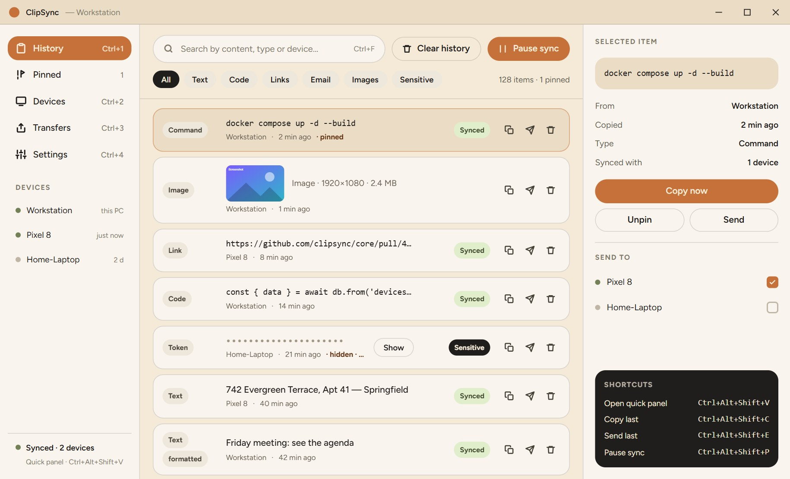
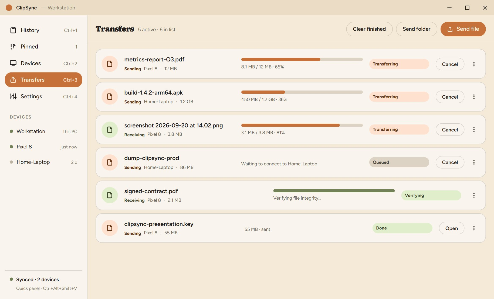
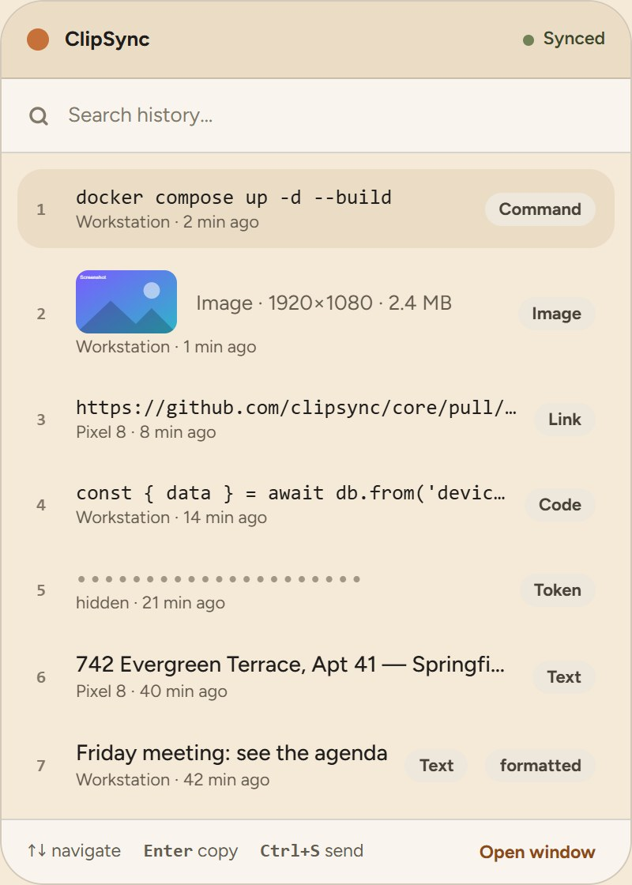
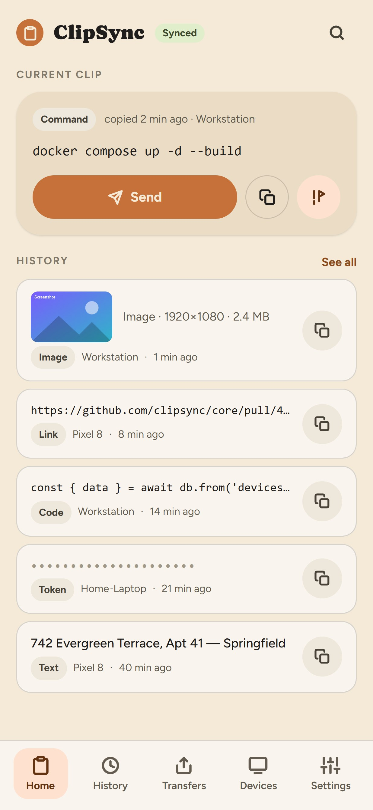
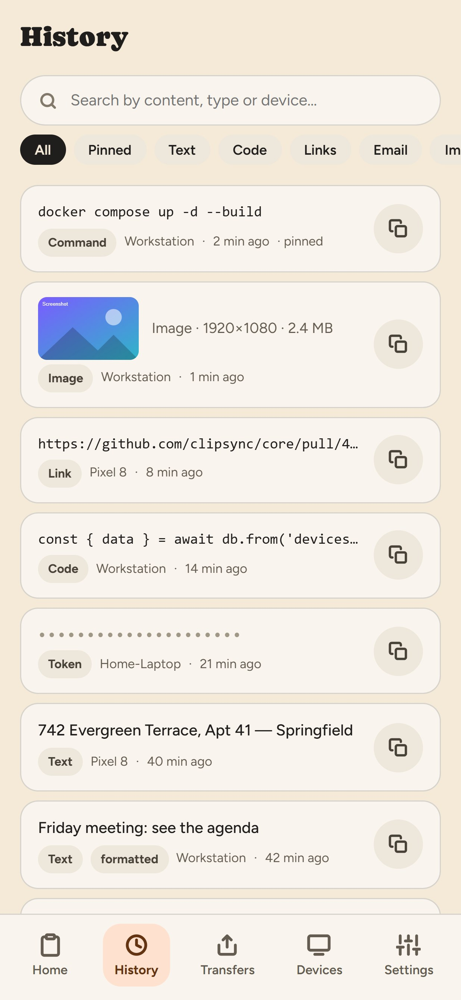
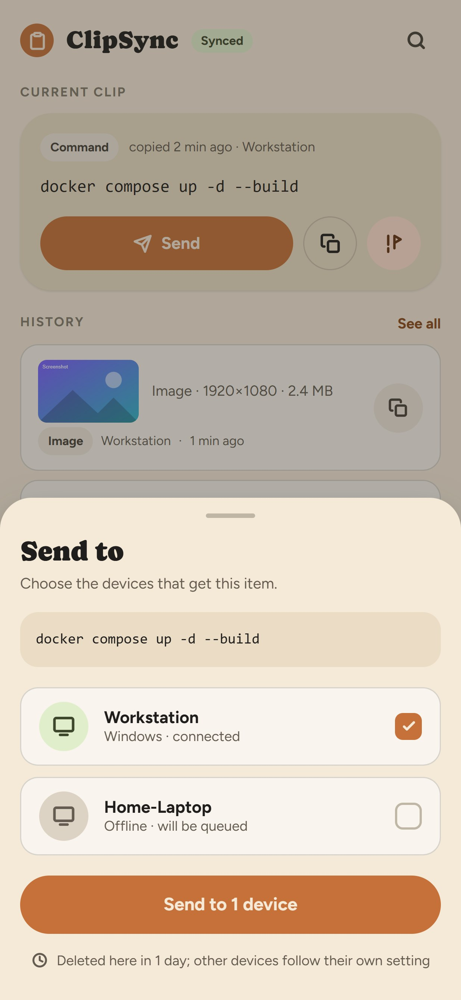

<p align="right"><a href="README.pt-BR.md">Leia em português</a></p>

# ClipSync

ClipSync syncs the clipboard and sends files between Windows and Android over your local network.
Copy something on the PC and paste it on the phone, or the other way around. Text, links, images and
files of any size go straight from one device to the other over Wi-Fi, end-to-end encrypted, with no
server, no account and no cloud. Devices are paired once with a QR code, and each one keeps a shared,
searchable clipboard history.

## Screenshots

**Windows**

<p>
  
  
  
</p>

**Android**

<p>
  
  
  
</p>

[More images here](docs/screenshots/en)

## Running

```bash
npm install
npm run tauri dev           # Windows
npm run tauri android dev   # Android
```

## Requirements

- Node 20+
- Rust (rustup)
- Windows: Visual Studio Build Tools with "Desktop development with C++"
- Android: Android SDK + NDK, JDK 17+, `ANDROID_HOME` and `NDK_HOME` set, and the Rust targets:

```bash
rustup target add aarch64-linux-android armv7-linux-androideabi i686-linux-android x86_64-linux-android
```
