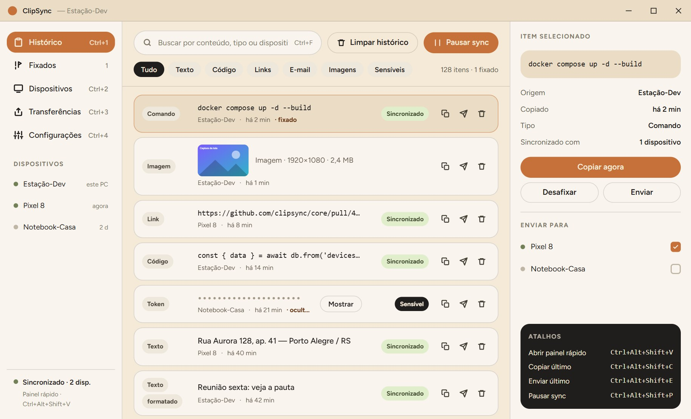
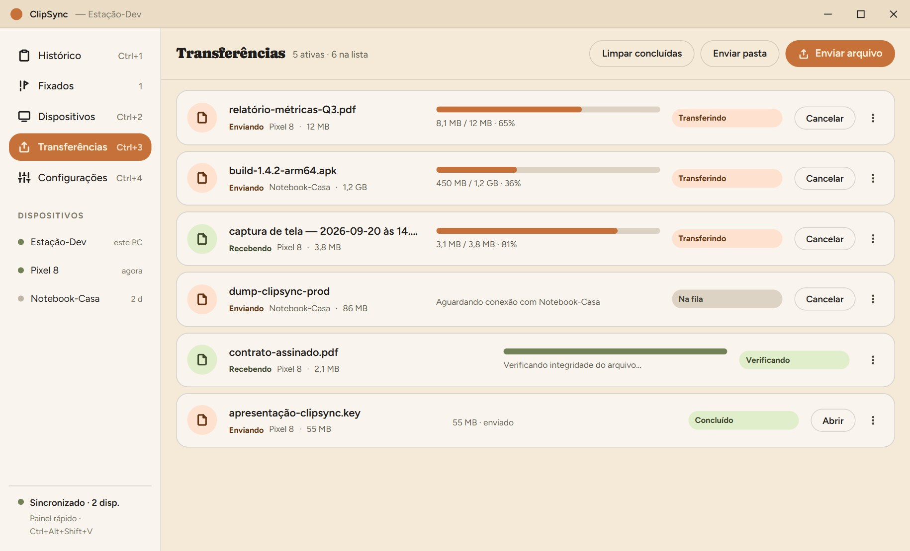
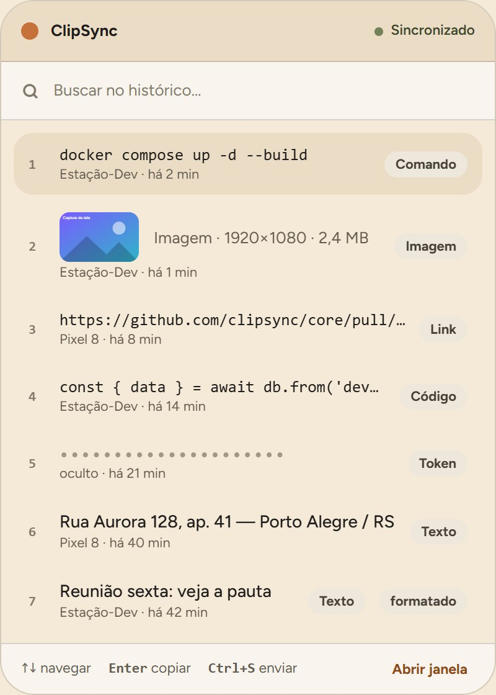
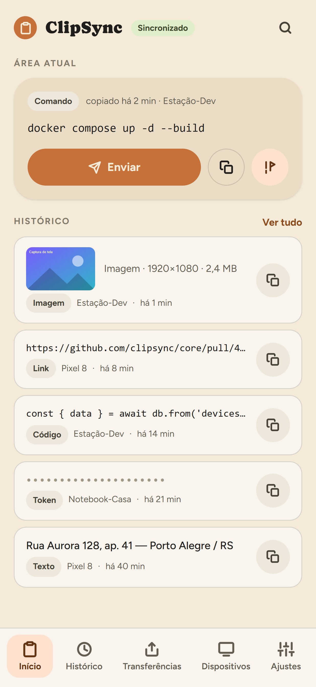
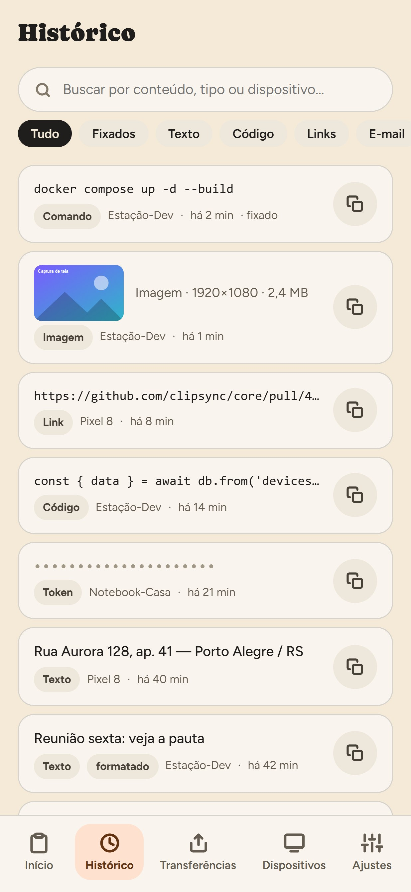
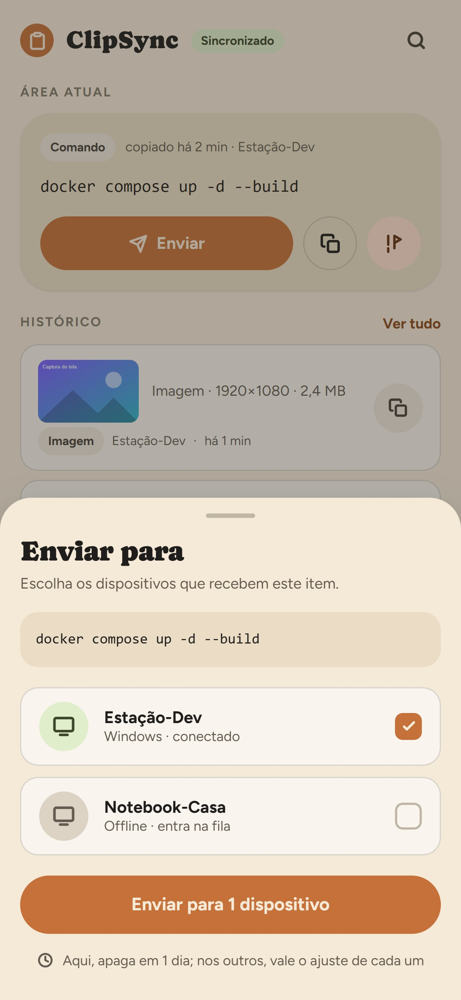

<p align="right"><a href="README.md">Read in English</a></p>

# ClipSync

O ClipSync sincroniza a área de transferência e envia arquivos entre Windows e Android pela sua rede local.
Copia no PC e cola no celular, ou o contrário. Texto, links, imagens e arquivos de qualquer tamanho vão
direto de um aparelho para o outro pelo Wi-Fi, com criptografia de ponta a ponta, sem servidor, sem conta
e sem nuvem. Os dispositivos são pareados uma vez por QR code, e cada um mantém um histórico de clipboard
compartilhado e pesquisável.

## Prints

**Windows**

<p>
  
  
  
</p>

**Android**

<p>
  
  
  
</p>

[Mais imagens aqui](docs/screenshots/pt)

## Como rodar

```bash
npm install
npm run tauri dev           # Windows
npm run tauri android dev   # Android
```

## Requisitos

- Node 20+
- Rust (rustup)
- Windows: Visual Studio Build Tools com "Desktop development with C++"
- Android: Android SDK + NDK, JDK 17+, `ANDROID_HOME` e `NDK_HOME` definidos, e os targets do Rust:

```bash
rustup target add aarch64-linux-android armv7-linux-androideabi i686-linux-android x86_64-linux-android
```
